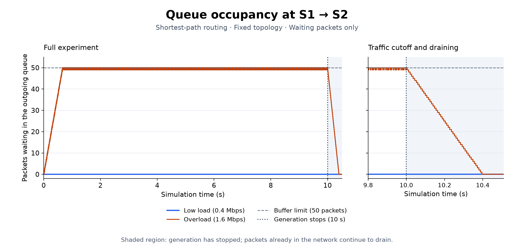

# Predictive Routing for Dynamic LEO Satellite Networks

An ongoing ECE627 course project investigating whether congestion
forecasting can improve routing in dynamic LEO satellite networks.

## Current implementation

The current stage is a Python discrete-event simulator with:

- Two gateways and four satellites forming two directed alternative paths.
- Shortest-path routing based on total propagation delay.
- Finite FIFO queues associated with outgoing links.
- Separate transmission and propagation delays.
- Multiple packets, queue waiting, and buffer-overflow drops.
- Packet accounting checks after every event.
- Sustained low-load and overload experiments with queue-occupancy plots.

Satellite motion and machine learning are planned extensions.

## Setup

Tested with Python 3.14.3, NetworkX 3.7, and Matplotlib 3.11.2.
Run these commands from the repository root on macOS/Linux:

```bash
python3 -m venv .venv
source .venv/bin/activate
python -m pip install networkx==3.7 matplotlib==3.11.2
```

For subsequent terminal sessions, activate the existing environment:

```bash
source .venv/bin/activate
```

## Run the demo

```bash
PYTHONPATH=src python -m satellite_routing.simulator
```

The demo generates three 8,000-bit packets at 0, 5, and 10 ms.
They follow G1 → S1 → S2 → G2.

| Packet | Creation time | Delivery time | Queue wait | End-to-end delay |
|---|---:|---:|---:|---:|
| 1 | 0 ms | 18 ms | 0 ms | 18 ms |
| 2 | 5 ms | 26 ms | 3 ms | 21 ms |
| 3 | 10 ms | 34 ms | 6 ms | 24 ms |

Expected outcome: three delivered packets, zero drops, and an empty
network after completion.

## Run sustained traffic experiments

```bash
PYTHONPATH=src python -m satellite_routing.experiment
```

Both cases use the fixed demo topology, the G1 → S1 → S2 → G2 shortest
path, 8,000-bit packets, and 10 seconds of regular traffic generation:

| Case | Packet interval | Offered load | Bottleneck capacity | Queue capacity |
|---|---:|---:|---:|---:|
| Low load | 20 ms | 0.4 Mbps | 1 Mbps | 50 waiting packets per link |
| Overload | 5 ms | 1.6 Mbps | 1 Mbps | 50 waiting packets per link |

Runs start empty, with no warm-up. Throughput counts payload delivered during
`[0, 10 seconds)`. Final counts and delivered-packet delay averages include
draining after generation stops. Drain time is reported separately.

## Generate the queue-occupancy plot

```bash
PYTHONPATH=src python -m satellite_routing.plotting
```

This reruns both experiments and saves
`results/queue_occupancy_low_vs_overload.png`. Rerunning replaces that image.
The figure shows the S1 → S2 queue over the full run and a zoom around the
10-second generation cutoff. It marks the buffer limit and includes draining.
Queue occupancy counts waiting packets, excluding the transmitting packet.
At identical timestamps, the last recorded state is used in the step plot.



## Run the tests

```bash
PYTHONPATH=src python -m unittest discover -s tests -v
```

The 23 tests cover queueing, overflow, concurrent paths, event ordering,
packet sizes, input validation, single-packet behavior, experiment metrics,
and queue histories.

## Code organization

- `models.py`: node, packet, and directed-link objects.
- `topology.py`: the fixed demonstration network.
- `routing.py`: propagation-delay shortest-path routing.
- `simulator.py`: event scheduling, packet forwarding, and results.
- `experiment.py`: sustained traffic generation and performance summaries.
- `plotting.py`: queue-occupancy comparison figure.
- `tests/test_simulator.py`: simulator correctness checks.
- `tests/test_experiment.py`: experiment and measurement checks.

Source modules are under `src/satellite_routing/`.

## Modeling assumptions

- Topology and link capacities remain fixed during each run.
- The demo uses equal-size packets; packet objects support different sizes.
- Buffer limits count waiting packets, excluding the transmitting packet.
- Each link has an independent transmitter.
- Satellites receive a complete packet before forwarding it.
- Routing uses propagation delay only; measured end-to-end delay also
  includes transmission and queueing.
- All pending events are processed before the run ends.

## Planned work

- Traffic-load sweep, CSV export, and delay/throughput/loss comparison plots.
- Larger networks with movement-driven connectivity changes.
- Reactive routing comparisons.
- GNN–GRU congestion forecasting and predictive routing evaluation.
